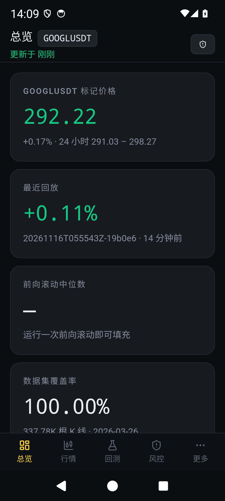
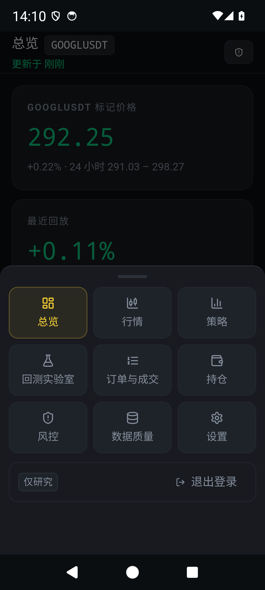
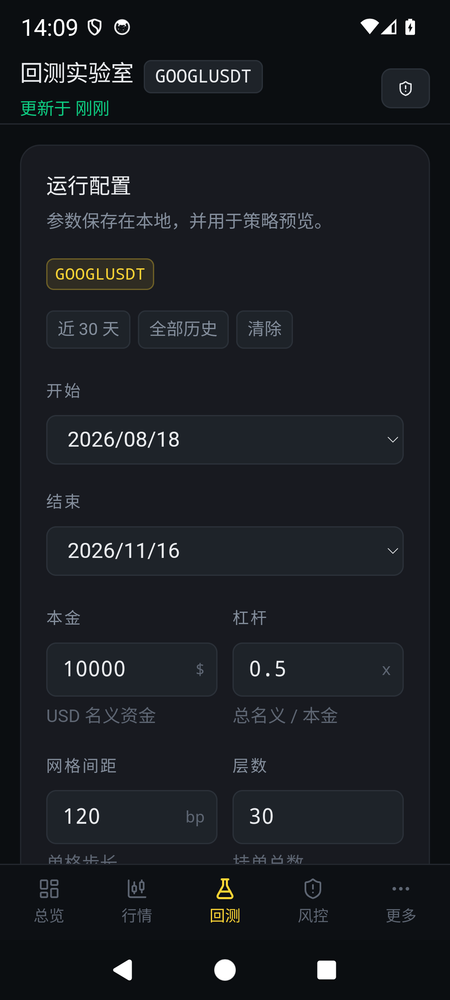
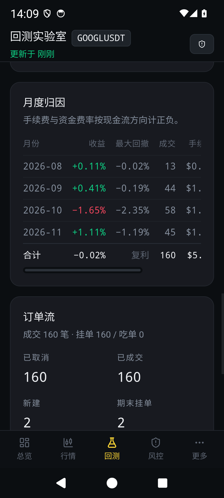
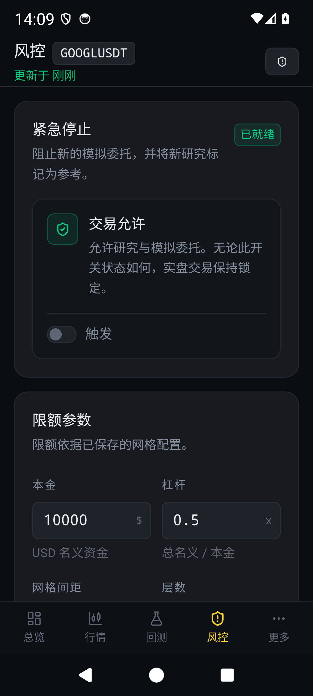

# Gridtrade Panel

A single-user quant trading panel for the `gridtrade` engine: a FastAPI backend with
SQLite persistence and a background research queue, plus one React SPA that ships in two
shells — a browser (desktop layout) and a WebView APK (mobile layout with bottom
navigation).

The panel is **research and paper only**. Live execution is visibly present but locked:
there is no live adapter, no order reconciliation and no listenKey renewal, so the entry
point exists purely to make the boundary explicit.



## What is in the box

```
src/gridtrade/            engine, strategy, OMS, simulated execution, research runner
src/gridtrade/api/        FastAPI app, config, store (SQLite), job queue, live feed
web/                      React 19 + Vite 6 + Tailwind 4 SPA (hash router, 9 routes)
apk/                      No-Gradle Android build: manifest, one Activity, build.sh
research/                 parquet datasets, fetch script, backtest helpers
tests/                    pytest suite (domain, engine, OMS, risk, sim, strategy)
docs/screens/             APK acceptance screenshots (Pixel 6 emulator)
```

## Requirements

| Tool | Version |
| --- | --- |
| Python | 3.12+ |
| Node | 22.x |
| pnpm | 10+ |
| Android SDK | build-tools 36.0.0, platform android-34, JDK 21 (APK only) |

## Run it

```bash
python3 -m venv .venv
.venv/bin/pip install -e '.[dev]'

cd web && pnpm install && pnpm build && cd ..

.venv/bin/python -m gridtrade.api
# -> http://127.0.0.1:8000  (SPA + API on the same origin)
```

The SPA is served from `web/dist`. For frontend work, run the Vite dev server instead
(proxies `/api` and `/ws` to port 8000):

```bash
cd web && pnpm dev     # http://localhost:5173
.venv/bin/python -m gridtrade.api
```

### Sign in

The first boot writes a random token to `var/token` (mode `0600`). Paste it into the
login screen, or read it with `cat var/token`.

The token is accepted as `Authorization: Bearer <token>`, as `X-API-Token: <token>`, or
as the `gt_token` httpOnly cookie set by `/api/auth/login`. WebSockets authenticate with
`?token=<token>` because browsers cannot set headers on the handshake.

### Configuration

Everything is environment-driven and local by default:

| Variable | Default | Purpose |
| --- | --- | --- |
| `GRIDTRADE_HOST` | `127.0.0.1` | Bind address (set `0.0.0.0` for LAN) |
| `GRIDTRADE_PORT` | `8000` | HTTP port |
| `GRIDTRADE_TOKEN` | generated | Override the token instead of reading `var/token` |
| `GRIDTRADE_DATA` | `research/data` | Parquet dataset directory |
| `GRIDTRADE_VAR` | `var` | SQLite DB, token, run artifacts |
| `GRIDTRADE_WEB` | `web/dist` | Built SPA |
| `GRIDTRADE_SYMBOL` | `GOOGLUSDT` | Default symbol |
| `GRIDTRADE_AUTORUN` | `1` | Mark runs left queued/running by a previous process as failed on boot |
| `GRIDTRADE_SECURE_COOKIE` | `0` | Set `Secure` on the auth cookie (HTTPS only) |
| `GRIDTRADE_CORS_ORIGINS` | localhost:5173 | Comma-separated dev origins |

Exposing the panel beyond localhost:

- LAN / Tailscale: `GRIDTRADE_HOST=0.0.0.0`, then open `http://<host>:8000`.
- Public network: put it behind an HTTPS tunnel or reverse proxy and set
  `GRIDTRADE_SECURE_COOKIE=1`. Plain HTTP is acceptable only on a private network.

## Pages

| Route | Content |
| --- | --- |
| `#/overview` | Latest replay equity + drawdown, walk-forward months, execution modes, data feed, recent runs |
| `#/market` | Candles with fill markers, funding rate history, carry summary |
| `#/strategy` | Grid parameters, sanity checks, live preview of band, exposure and stop risk |
| `#/backtest` | Replay / walk-forward / sweep, monthly attribution, order flow, equity + drawdown |
| `#/orders` | Run picker, order/fill tables, rejection reasons, resting orders |
| `#/positions` | Simulated position, grid state, per-level inventory |
| `#/risk` | Derived limits, drawdown guard, kill switch, rejection counters |
| `#/quality` | Bar coverage, gaps, timestamp monotonicity, filter metadata |
| `#/settings` | Server address, token, execution modes, kill switch, storage paths, audit log |

Navigation is responsive: sidebar on `lg`, bottom bar plus a "More" drawer below it.
The layout is verified at 360×800 CSS with `font_scale 1.3` and no horizontal overflow
on any route (`document.scrollWidth == clientWidth`).

## API

All `/api/*` routes except `/api/health` and `/api/auth/login` require the token.

| Method | Path | Notes |
| --- | --- | --- |
| GET | `/api/health` | Unauthenticated liveness probe |
| POST | `/api/auth/login` | `{token}` -> sets `gt_token` cookie |
| POST | `/api/auth/logout` | Clears the cookie |
| GET | `/api/session` | Current auth + server info |
| GET | `/api/dataset/symbols` | Symbols present in the dataset |
| GET | `/api/dataset/quality` | Coverage, gaps, schema checks |
| GET | `/api/market/snapshot` | Mark/index/last price, 24h range and volume, funding (public REST, `offline` on failure) |
| GET | `/api/market/candles` | Downsampled OHLCV for charts |
| GET | `/api/market/funding` | Funding rate history |
| GET | `/api/overview` | Aggregate cards for the landing page |
| GET | `/api/runs` | Run history |
| GET | `/api/runs/{id}` | Status, progress, summary |
| GET | `/api/runs/{id}/artifact` | Fills, orders, equity, monthly rows |
| POST | `/api/runs/{id}/cancel` | Cooperative cancel |
| POST | `/api/runs/replay` | 202 + queued replay |
| POST | `/api/runs/walkforward` | 202 + queued walk-forward |
| POST | `/api/runs/sweep` | 202 + queued sweep (<= 48 combos) |
| GET | `/api/risk` | Limits, drawdown state, kill switch |
| POST | `/api/settings/kill-switch` | Arm/disarm |
| GET | `/api/settings` | Server-side settings |
| GET | `/api/audit` | Audit trail |
| WS | `/ws?token=` | Pushes market snapshot + run status every 3 s |

Interactive docs: `http://127.0.0.1:8000/docs`.

## Research data

The panel reads Minute-level Binance USDⓈ-M futures parquet files
(`GOOGLUSDT_1m.parquet`, `GOOGLUSDT_funding.parquet`). Refresh them with:

```bash
.venv/bin/python research/fetch.py --symbol GOOGLUSDT
```

Jobs run on two worker threads, write progress to SQLite and can be cancelled between
chunks. Replays are deterministic for a fixed dataset and parameter set.

## Android APK

The APK is built without Gradle: `aapt2 -> javac (release 17) -> d8 -> zip -> zipalign -> apksigner`.

```bash
./apk/build.sh                    # -> apk/gridtrade.apk
adb install -r apk/gridtrade.apk
```

The Activity asks for a server address and token on first launch (long-press or the
overflow menu reopens it), defaults to `http://10.0.2.2:8000` (the emulator's alias for
the host), and stores both in `SharedPreferences`. It also syncs the token into WebView
`localStorage` so the SPA does not ask twice.

Notes:

- `minSdk 26`, `target 34`, cleartext HTTP allowed for LAN/Tailscale use.
- `apk/gridtrade.jks` is a locally generated keystore (password `gridtrade`) for
  sideloading only — re-sign with your own key before distributing.
- Changing only the web UI does not require an APK rebuild: the Activity loads
  `web/dist` from the server. Rebuild the APK only for Java, manifest or resource changes.

Acceptance screenshots (emulator, `font_scale 1.3`, density 480):

| | |
| --- | --- |
|  |  |
|  |  |

## Tests

```bash
.venv/bin/python -m pytest            # 53 tests
cd web && pnpm typecheck              # tsc --noEmit
```

## Deliberate limits

- **Live trading is locked.** `MODES` enables `research` only; `paper` is scaffolded and
  `live` has no adapter. No exchange keys are ever requested or stored.
- Single user, single process. Writes are serialized with a lock; SQLite runs in WAL mode
  with short-lived connections.
- Market snapshot uses the public Binance REST endpoint and degrades to
  `source: "offline"` rather than blocking the UI.
- Simulated fills use the minute bar's high/low; funding is charged from the recorded
  funding events, so monthly attribution includes it.
