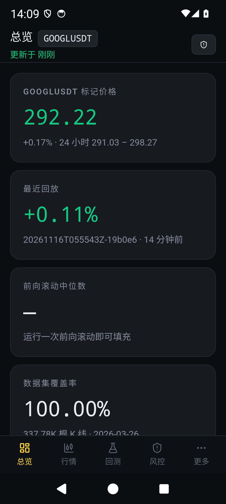
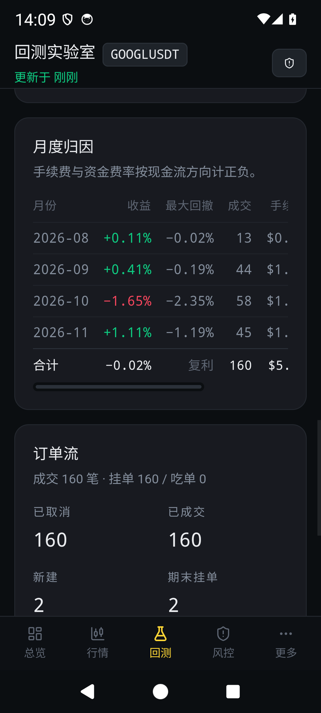

# Gridtrade Panel

面向 `gridtrade` 引擎的单用户量化面板：FastAPI 后端（SQLite 持久化 + 后台研究队列），
以及一套同时服务两种外壳的 React 单页应用——浏览器（桌面侧边栏）与 WebView APK
（移动端底部导航）。

面板**仅用于研究与模拟**。实盘入口可见但处于锁定状态：没有实盘适配器、没有订单对账、
没有 listenKey 续期，这个入口的存在只是为了让边界清晰。

英文文档见 [README.en.md](README.en.md)。



## 包含什么

```
src/gridtrade/            引擎、策略、OMS、模拟撮合、研究运行器
src/gridtrade/api/        FastAPI 应用、配置、SQLite 存储、任务队列、行情推送
web/                      React 19 + Vite 6 + Tailwind 4 单页应用（hash 路由，9 个页面）
apk/                      无 Gradle 的 Android 构建：manifest、单个 Activity、build.sh
research/                 parquet 数据集、抓取脚本、回测辅助
tests/                    pytest 用例（领域、引擎、OMS、风控、模拟、策略）
docs/screens/             APK 验收截图（Pixel 6 模拟器）
```

## 环境要求

| 工具 | 版本 |
| --- | --- |
| Python | 3.12+ |
| Node | 22.x |
| pnpm | 10+ |
| Android SDK | build-tools 36.0.0、platform android-34、JDK 21（仅构建 APK 需要） |

## 启动

```bash
python3 -m venv .venv
.venv/bin/pip install -e '.[dev]'

cd web && pnpm install && pnpm build && cd ..

.venv/bin/python -m gridtrade.api
# -> http://127.0.0.1:8000  （SPA 与 API 同源）
```

SPA 从 `web/dist` 提供。做前端开发时改用 Vite dev server（把 `/api`、`/ws` 代理到 8000）：

```bash
cd web && pnpm dev     # http://localhost:5173
.venv/bin/python -m gridtrade.api
```

### 在线实例

当前部署在 `http://81.71.71.131:8000`（systemd 常驻，令牌在服务器的 `var/token`）。
该实例目前是明文 HTTP，仅建议临时使用；公网长期使用应加 HTTPS 反向代理，详见
[docs/memory/03-部署与运维手册.md](docs/memory/03-部署与运维手册.md)。

### 登录

首次启动会生成随机令牌写入 `var/token`（权限 `0600`）。把它粘贴到登录页，或用
`cat var/token` 查看。

令牌支持三种传递方式：`Authorization: Bearer <token>`、`X-API-Token: <token>`，以及
`/api/auth/login` 设置的 `gt_token` httpOnly Cookie。WebSocket 用 `?token=<token>`
认证，因为浏览器无法为握手设置请求头。

### 配置

全部通过环境变量控制，默认只监听本机：

| 变量 | 默认值 | 作用 |
| --- | --- | --- |
| `GRIDTRADE_HOST` | `127.0.0.1` | 监听地址（局域网使用设 `0.0.0.0`） |
| `GRIDTRADE_PORT` | `8000` | HTTP 端口 |
| `GRIDTRADE_TOKEN` | 自动生成 | 覆盖令牌，不再读取 `var/token` |
| `GRIDTRADE_DATA` | `research/data` | Parquet 数据集目录 |
| `GRIDTRADE_VAR` | `var` | SQLite 数据库、令牌、任务产物 |
| `GRIDTRADE_WEB` | `web/dist` | 构建后的 SPA |
| `GRIDTRADE_SYMBOL` | `GOOGLUSDT` | 默认交易对 |
| `GRIDTRADE_AUTORUN` | `1` | 启动时把上一进程遗留的排队/运行中任务标记为失败 |
| `GRIDTRADE_SECURE_COOKIE` | `0` | 为认证 Cookie 加 `Secure`（仅 HTTPS） |
| `GRIDTRADE_CORS_ORIGINS` | localhost:5173 | 逗号分隔的开发源 |

在 localhost 之外暴露面板：

- 局域网 / Tailscale：`GRIDTRADE_HOST=0.0.0.0`，然后访问 `http://<host>:8000`。
- 公网：放在 HTTPS 隧道或反向代理之后，并设置 `GRIDTRADE_SECURE_COOKIE=1`。
  只有私有网络才适合直接使用明文 HTTP。

## 页面

| 路由 | 内容 |
| --- | --- |
| `#/overview` | 最新回放权益与回撤、前向滚动月度结果、执行模式、数据源、最近任务 |
| `#/market` | 带成交标记的 K 线、资金费率历史、套息汇总 |
| `#/strategy` | 网格参数、参数校验、价格区间/敞口/止损风险的实时预览 |
| `#/backtest` | 回放 / 前向滚动 / 参数扫描、月度归因、订单流、权益与回撤 |
| `#/orders` | 任务选择、订单/成交表、拒单原因、期末挂单 |
| `#/positions` | 模拟持仓、网格状态、分层库存 |
| `#/risk` | 派生限额、回撤保护、紧急停止、拒单计数 |
| `#/quality` | K 线覆盖、缺口、时间戳单调性、交易规则元数据 |
| `#/settings` | 服务器地址、令牌、执行模式、紧急停止、存储路径、审计日志 |

导航是响应式的：`lg` 及以上为侧边栏，以下为底部导航栏加“更多”抽屉。
布局已在 360×800 CSS、`font_scale 1.3` 下验证，所有路由均无横向溢出
（`document.scrollWidth == clientWidth`）。

## API

除 `/api/health` 与 `/api/auth/login` 外，所有 `/api/*` 路由都需要令牌。

| 方法 | 路径 | 说明 |
| --- | --- | --- |
| GET | `/api/health` | 免鉴权存活探针 |
| POST | `/api/auth/login` | `{token}` -> 设置 `gt_token` Cookie |
| POST | `/api/auth/logout` | 清除 Cookie |
| GET | `/api/session` | 当前鉴权状态与服务端信息 |
| GET | `/api/dataset/symbols` | 数据集中存在的交易对 |
| GET | `/api/dataset/quality` | 覆盖率、缺口、结构校验 |
| GET | `/api/market/snapshot` | 标记/指数/最新价、24h 区间与成交量、资金费率（公共 REST，失败时标记 `offline`） |
| GET | `/api/market/candles` | 降采样 OHLCV，用于图表 |
| GET | `/api/market/funding` | 资金费率历史 |
| GET | `/api/overview` | 首页聚合卡片 |
| GET | `/api/runs` | 任务历史 |
| GET | `/api/runs/{id}` | 状态、进度、摘要 |
| GET | `/api/runs/{id}/artifact` | 成交、订单、权益曲线、月度行 |
| POST | `/api/runs/{id}/cancel` | 协作式取消 |
| POST | `/api/runs/replay` | 202 + 排队中的回放 |
| POST | `/api/runs/walkforward` | 202 + 排队中的前向滚动 |
| POST | `/api/runs/sweep` | 202 + 排队中的参数扫描（组合数 ≤ 48） |
| GET | `/api/risk` | 限额、回撤状态、紧急停止 |
| POST | `/api/settings/kill-switch` | 触发/解除紧急停止 |
| GET | `/api/settings` | 服务端设置 |
| GET | `/api/audit` | 审计日志 |
| WS | `/ws?token=` | 每 3 秒推送行情快照与任务状态 |

交互式文档：`http://127.0.0.1:8000/docs`。

## 研究数据

面板读取币安 USDⓈ-M 永续合约的分钟级 parquet 文件
（`GOOGLUSDT_1m.parquet`、`GOOGLUSDT_funding.parquet`）。刷新方式：

```bash
.venv/bin/python research/fetch.py --symbol GOOGLUSDT
```

任务在两个工作线程上运行，进度写入 SQLite，可在分块之间取消。对于固定的数据集与
参数组合，回放结果是确定性的。

## Android APK

APK 不使用 Gradle 构建：`aapt2 -> javac (release 17) -> d8 -> zip -> zipalign -> apksigner`。

```bash
./apk/build.sh                    # -> apk/gridtrade.apk
adb install -r apk/gridtrade.apk
```

部分 OPPO/OnePlus 机型会在 `adb install` 时卡在安装引导，可改用
`pm install-create` / `pm install-write` / `pm install-commit` 分段安装。

首次启动时 Activity 会要求填写服务器地址与令牌；进入面板后，在页面历史尽头按返回键
可重新打开“服务器与令牌”菜单。
默认 `http://81.71.71.131:8000`（当前部署地址），两者都存入 `SharedPreferences`。
令牌还会同步写入 WebView 的 `localStorage`，避免 SPA 再次询问。

注意：

- `minSdk 26`、`target 34`，允许明文 HTTP 以便局域网/Tailscale 使用。
- `apk/gridtrade.jks` 是本地生成的密钥库（口令 `gridtrade`），仅用于侧载——
  分发前请用自己的密钥重新签名。
- 只改 Web UI 不需要重建 APK：Activity 从服务端加载 `web/dist`。只有 Java、
  manifest 或资源变更才需要重建 APK。

验收截图（模拟器，`font_scale 1.3`，density 480）：

| | |
| --- | --- |
|  |  |
|  |  |

## 开发交接与记忆文档

换一台电脑继续开发时，先读 [docs/memory/README.md](docs/memory/README.md)。其中包含：

- [项目总览与架构](docs/memory/01-项目总览与架构.md)
- [开发进度与变更记录](docs/memory/02-开发进度与变更记录.md)
- [部署与运维手册](docs/memory/03-部署与运维手册.md)
- [测试手册](docs/memory/04-测试手册.md)（桌面 Web 与真机 APK 的可复现步骤）
- [问题与决策记录](docs/memory/05-问题与决策记录.md)
- [下一步与待办](docs/memory/06-下一步与待办.md)
- [记忆库原始笔记](docs/memory/vault/)

仓库不包含令牌（`var/token`）、行情数据（`research/data/`）、签名密钥（`apk/*.jks`）
与前端构建产物（`web/dist/`），恢复步骤见交接文档。

## 测试

```bash
.venv/bin/python -m pytest            # 53 项
cd web && pnpm typecheck              # tsc --noEmit
```

## 有意为之的边界

- **实盘交易处于锁定状态。** `MODES` 只启用 `research`；`paper` 已搭好骨架，
  `live` 没有适配器。任何时候都不会索取或保存交易所密钥。
- 单用户、单进程。写入通过锁串行化；SQLite 使用 WAL 模式与短连接。
- 行情快照走币安公共 REST，失败时降级为 `source: "offline"`，而不是阻塞界面。
- 模拟成交使用分钟 K 线的最高/最低价；资金费率按记录的资金事件扣缴，
  因此月度归因包含资金费。
